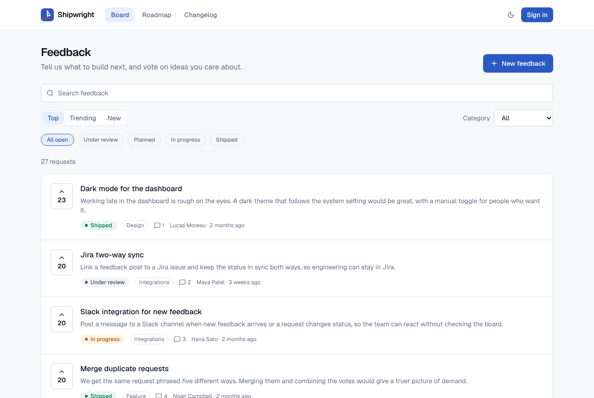
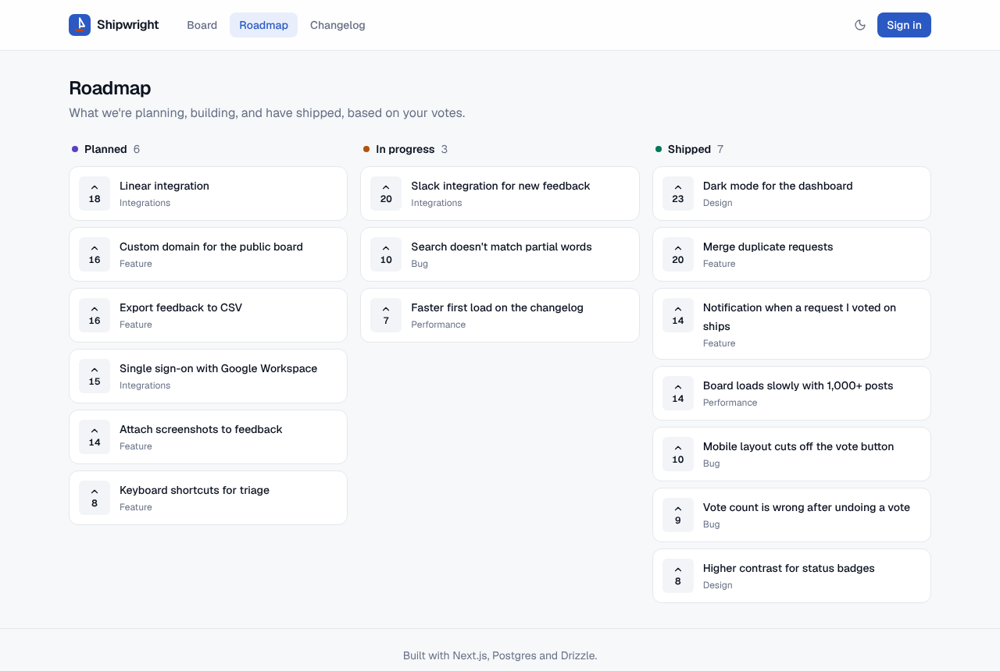
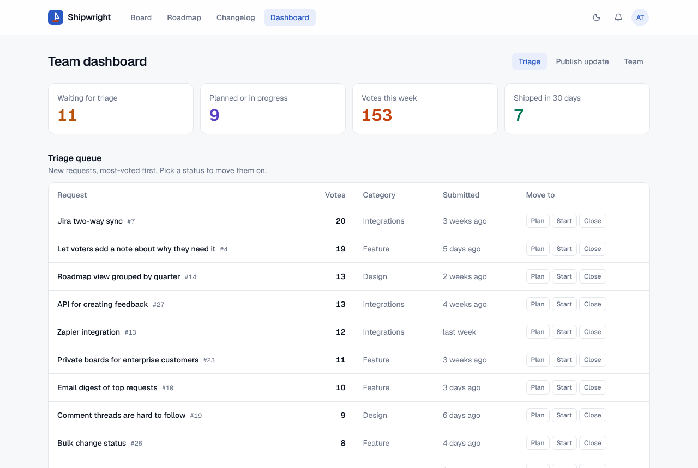
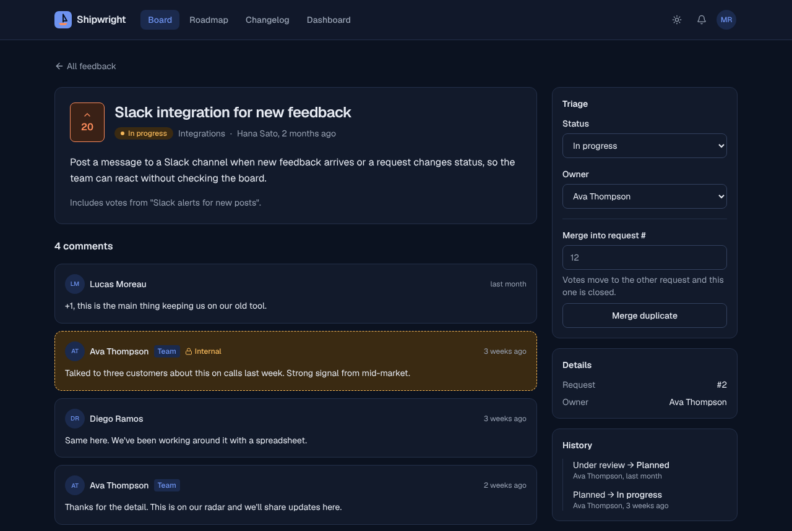

# Shipwright

A product feedback tool built with Next.js 16. Customers post ideas and vote on them. The team triages requests onto a public roadmap, then publishes changelog updates that notify everyone who asked.



| Roadmap                                   | Team dashboard                                | Dark mode                                 |
| ----------------------------------------- | --------------------------------------------- | ----------------------------------------- |
|  |  |  |

## What it does

- **Feedback board:** full-text search, filters for status and category, three sort orders (trending, top, new) and pagination. Every filter lives in the URL, so views can be shared and the back button works.
- **Voting:** the count updates instantly (optimistic UI) and rolls back if the server rejects the vote. A row lock on the server keeps counts correct when someone clicks rapidly or votes from several tabs.
- **Comments:** public discussion, plus internal notes that only the team can see.
- **Team triage:** move requests through `Under review → Planned → In progress → Shipped`, assign owners, and merge duplicates. Merged votes are combined without counting anyone twice.
- **Roadmap and changelog:** a public roadmap, and changelog posts that mark the linked requests as shipped.
- **Notifications:** voters and authors hear when a request changes status, ships, gets merged or receives a comment.
- **Roles:** customer, team member and admin, set up as a permission matrix and checked on the server for every change.
- **Dark mode and accessibility:** an automated test checks every color pair against WCAG AA in both themes, and axe checks five pages in CI.

## Quality at a glance

| Check                                   | Result                                                                |
| --------------------------------------- | --------------------------------------------------------------------- |
| Unit + integration tests (Vitest)       | 75 passing. Integration tests run against real Postgres               |
| End-to-end tests (Playwright)           | 15 passing: customer and team journeys, access control, axe audits    |
| Lighthouse (production build, mobile)   | Performance 99–100 · Best practices 100 · LCP 0.8–1.0 s · CLS 0       |
| TypeScript                              | `strict`, typed routes, no `any`                                      |
| CI                                      | Lint, typecheck, formatting, tests, production build and e2e on every PR |

## Run it locally

You need Node 20.9+ and Docker (or any Postgres 16).

```bash
cp .env.example .env            # then set SESSION_SECRET: openssl rand -base64 32
docker compose up -d            # Postgres on :5432 (also creates the test database)
npm install
npm run db:reset                # run migrations and load demo data
npm run dev                     # http://localhost:3000
```

On the sign-in page, pick a demo account. All three use the password `shipwright-demo`.

| Account                  | Role     | What they can do                                     |
| ------------------------ | -------- | ---------------------------------------------------- |
| ava@shipwright.dev       | Admin    | Everything, including changing team roles            |
| marcus@shipwright.dev    | Member   | Triage, internal notes, merge, publish updates       |
| jordan.blake@example.com | Customer | Post, vote and comment                               |

### Scripts

| Command             | What it does                                                    |
| ------------------- | --------------------------------------------------------------- |
| `npm run dev`       | Start the dev server                                            |
| `npm run check`     | Lint, typecheck, then run unit and integration tests            |
| `npm test`          | Unit and integration tests (needs `TEST_DATABASE_URL`)          |
| `npm run test:e2e`  | Build the app and run the Playwright suite against it          |
| `npm run db:reset`  | Apply migrations and reseed demo data                           |
| `npm run db:generate` | Create a migration after changing `src/db/schema.ts`          |

If Playwright can't download its own browser, `PW_CHANNEL=chrome npm run test:e2e` uses your installed Chrome.

## Architecture

```
src/
  app/                 Routes (App Router). Pages are thin: they compose components and call queries.
  components/          UI. Client components are marked "use client" and kept small.
  db/                  Drizzle schema and client
  lib/                 Pure, framework-free logic: permissions, status workflow, validation, utils
  server/
    services/          Business logic. Takes a DB handle + actor, no Next.js imports, fully tested
    queries.ts         Cached read layer ("use cache" + cache tags)
    actions/           Server Actions: authorize → validate → call a service → invalidate tags
    auth.ts            Data Access Layer: session → current user
  proxy.ts             Fast redirect for signed-out visitors (the real checks live in auth.ts)
tests/                 unit/ (jsdom), integration/ (real Postgres), e2e/ (Playwright)
docs/                  Architecture notes and decision records
```

How a write flows through the app:

```mermaid
sequenceDiagram
  participant UI as VoteButton (client)
  participant A as toggleVoteAction
  participant S as votes service
  participant DB as Postgres
  UI->>UI: useOptimistic: show the new count
  UI->>A: call the Server Action
  A->>A: requireActor("post:vote"): re-read session and role
  A->>S: toggleVote(db, actor, postId)
  S->>DB: BEGIN; SELECT … FOR UPDATE; insert/delete vote; update count; COMMIT
  A->>A: updateTag("posts"), updateTag("votes:<user>")
  A-->>UI: { voted, voteCount }, or a typed error and the UI rolls back
```

More detail is in [`docs/architecture.md`](docs/architecture.md) and the decision records in [`docs/adr`](docs/adr).

## Deploying

Vercel and [Neon](https://neon.tech) both have free tiers that work for this.

1. Create a Neon database and set `DATABASE_URL`, `SESSION_SECRET` and `NEXT_PUBLIC_APP_URL` in your Vercel project.
2. Run `npm run db:reset` once against that database (or just `npm run db:migrate` if you don't want demo data).
3. Deploy. The build prerenders public pages from the database, so the database has to be reachable when the build runs.

Set `DEMO_MODE=false` to hide the demo-account buttons on the sign-in page.

## Known limitations and next steps

- **Sign-in rate limiting** isn't implemented yet. In production I'd add a Redis or Upstash limiter, keyed by IP and email.
- **Email** notifications are in-app only. Next would be a queued email digest, using Resend plus a cron route.
- **Caching across instances:** `use cache` is per-instance in memory by default. With several servers I'd switch the hot queries to `use cache: remote`.
- **Lighthouse's meta-description check** flags `/posts/[id]`, because ordinary browsers receive that page's metadata streamed in after the page starts loading. Search-engine crawlers get it in `<head>` (Next.js serves them metadata before streaming), so it doesn't affect SEO.
