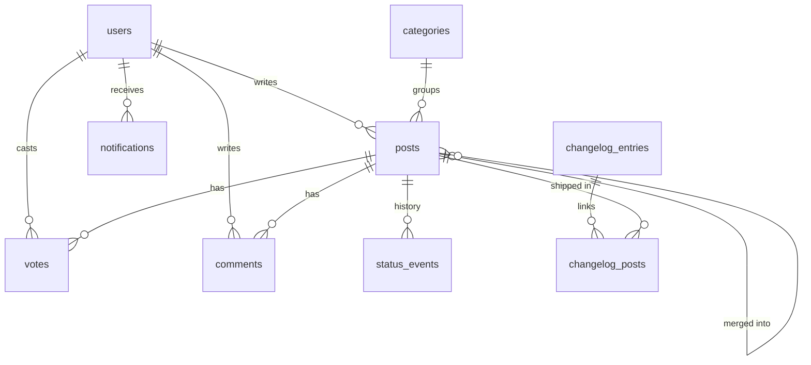

# Architecture

## Layers

The code is split so that the rules that matter can be tested without a browser or a framework.

| Layer | Location | Depends on | Tested by |
| --- | --- | --- | --- |
| Pure logic | `src/lib` | nothing | Unit tests |
| Services | `src/server/services` | Drizzle, `src/lib` | Integration tests against Postgres |
| Cached reads | `src/server/queries.ts` | services, `next/cache` | End-to-end tests |
| Server Actions | `src/server/actions` | services, auth, `next/cache` | End-to-end tests |
| UI | `src/app`, `src/components` | queries, actions | Component tests + end-to-end tests |

Services take a database handle (or an open transaction) and an `Actor`, and never import Next.js. That makes them easy to call from tests, scripts or a future API route, and lets one service call another inside the same transaction. Publishing a changelog entry, for example, calls `changeStatus` for each linked request, and all of it commits or rolls back together.

## Data model

Design choices worth noting:

- **Denormalised counters** (`vote_count`, `comment_count`) keep list queries to a single indexed scan. They're only changed inside transactions that lock the post row, and integration tests check that they match the real row counts, including when many votes arrive at once.
- **Generated `tsvector` column** with a GIN index gives full-text search, weighting titles above bodies, with no extra service to run.
- **`status_events`** is an append-only audit trail. It powers the post's history and could feed analytics such as time to ship.
- **Composite primary key on `votes`** `(post_id, user_id)` makes double voting impossible at the database level, not just in application code.
- **Partial index** on unread notifications keeps the bell's unread count cheap as notifications pile up.

## Rendering and caching

Next.js 16 with Cache Components and Partial Prerendering:

- Every read in `queries.ts` uses `"use cache"`, a `cacheLife` profile and one or more tags from `tags.ts`.
- Public pages (roadmap, changelog, the board's chrome) prerender into a static shell. Only request-specific parts, such as who's signed in, which posts you voted on and the search results for your query, stream in behind `<Suspense>`.
- Every Server Action calls `updateTag` for each tag it affects, so the person who made a change always sees it on the next render, while everyone else gets cached pages.
- Per-user data (votes, notifications) is cached under the user's id. The exported getter looks up the signed-in user itself, so no caller can pass someone else's id.
- Relative timestamps ("3 days ago") render in the browser, so cached HTML never shows stale times.

## Authorization

1. `proxy.ts` sends signed-out visitors away from private routes before any rendering. This only checks that a cookie exists, which is fast but not trusted.
2. `getCurrentUser()` (cached privately, in the browser only) decides what UI to show.
3. `requireActor(permission)` runs in every Server Action. It's deliberately uncached and re-reads the user's role from the database, so revoking a role takes effect immediately.
4. Services check permissions again with `can(actor, …)`. Any code path that reaches a service, including future API routes, is protected.

Permissions are a single matrix in `src/lib/permissions.ts`, covered by a table-driven test.
